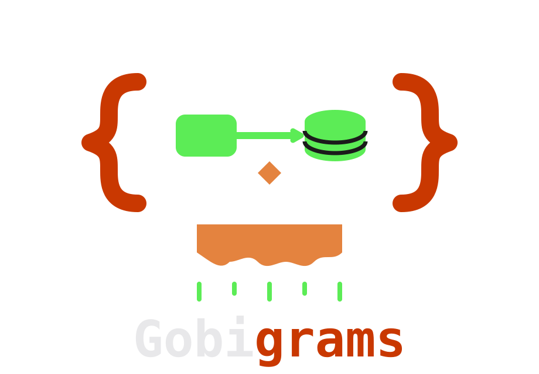
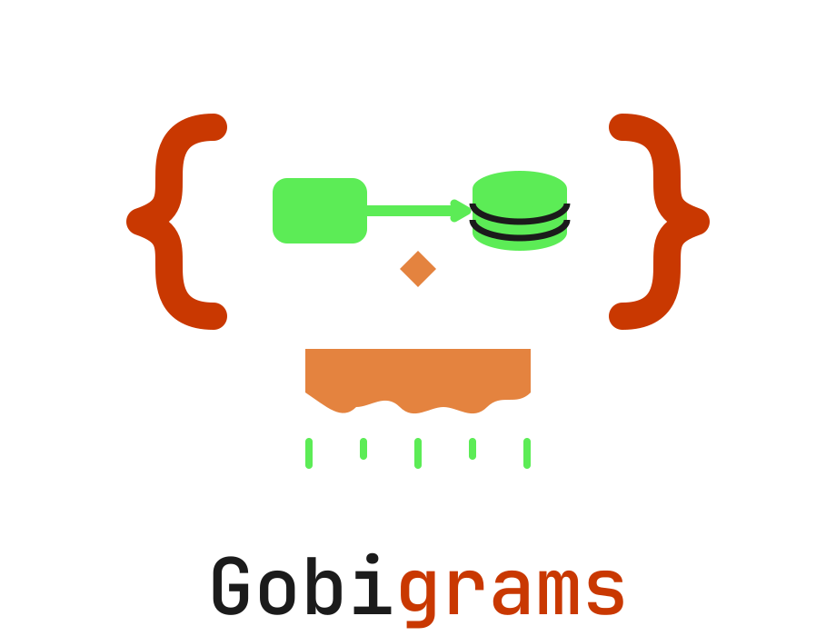
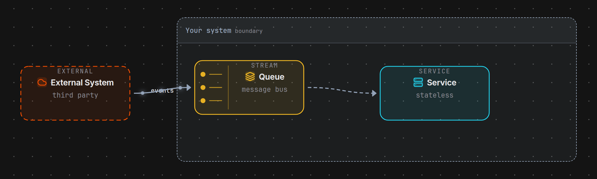
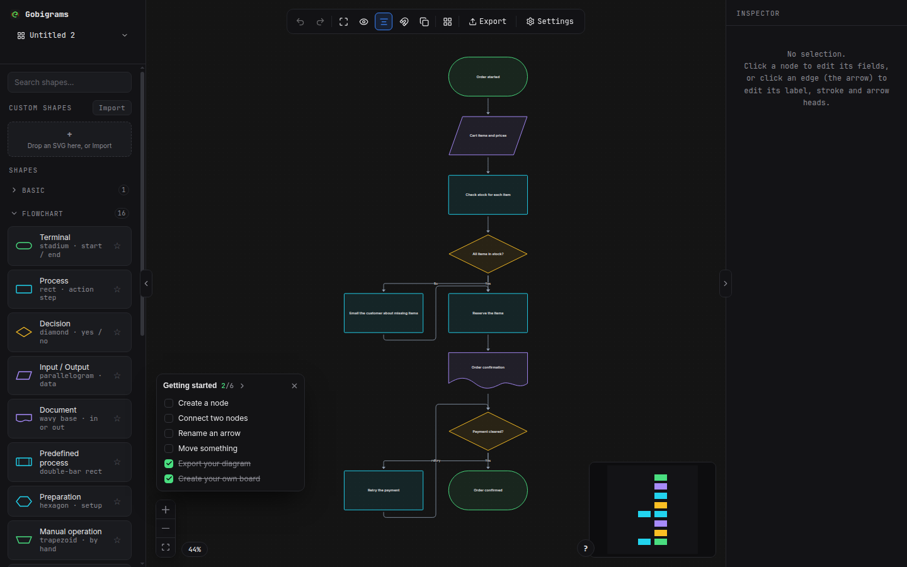

<p align="center">
  
  
</p>
<p align="center"><sub>{ G }</sub> — a tiny goblin with a ruler, living in your browser tab.</p>

# Gobigrams

**A browser-based diagram editor — flowcharts, architecture and ER diagrams — with real vector
SVG export, no account, and nothing stored on a server.** Live at
<https://gobigrams.tech-goblin.com>.

Diagrams, but with a goblin. **Gobigrams** is a single-page canvas where boxes
finally line up, arrows mean things, and the SVG you export is a *real vector
file with selectable text* — not a screenshot wearing a vector hat.

No account. No backend. No "please accept cookies" banner. The goblin counts
visitors with a cookieless, self-hosted tally counter and otherwise keeps his
nose out of your business. Your boards live in your browser until *you* decide
to export them.

> Status: v0.4.3 — feature-complete enough for daily use, still occasionally
> bumping into furniture. Report the bumps → [Support](./SUPPORT.md).

## What it looks like

<p align="center">
  
</p>
<p align="center"><sub>One board — exported as SVG, embedded anywhere. <a href="https://gobigrams.tech-goblin.com">Draw your own</a>.</sub></p>

<p align="center">
  
</p>
<p align="center"><sub>The editor: shapes on the left, the canvas, and an inspector for whatever you select.</sub></p>

## The short version

- 🧌 60+ shapes, custom SVG drops, tables, checklists — enough to draw the thing
- ➡️ Edges with intent: animated flow, cardinality, labels that ride the line
- 🌗 Five themes and per-element colours that survive a theme switch
- 📤 SVG (real text) · PNG · PDF · JSON · Mermaid import
- ⌨️ Keyboard-first: nudge, duplicate, align, auto-layout, full shortcut sheet in **?**
- 🗄️ Boards with autosave; storage is honest about where it keeps your stuff

The category-by-category inventory lives in **[FEATURES.md](./FEATURES.md)**.

## Run it

```bash
npm install
npm run dev          # http://localhost:5173
npm run build        # -> dist/ (fully static, host it anywhere)
```

Node.js 20+ and a modern browser. `dist/` runs behind any web server or CDN,
or even `file://`-style local serving.

## Build with it

The editor is not the only way in. The `.gobi` language is a package, and the app
you are looking at is just one of its doors — the same compiler, the same layout,
the same SVG, so a diagram made in code is byte-identical to one exported from the
canvas.

| Package | What it does | Get it |
|---|---|---|
| **[`@techgoblin/gobi-core`](./packages/gobi)** | `.gobi` text → SVG. No browser, no React, no canvas, zero dependencies. Build-time rendering, diagram-as-code in CI, an SVG endpoint, OG cards. | `npm i @techgoblin/gobi-core` |
| **[`@techgoblin/gobi-mcp`](./packages/gobi-mcp)** | An [MCP](https://modelcontextprotocol.io) server, so any AI agent can draw: `gobi_validate`, `gobi_render`, `gobi_png`, `gobi_describe`. | in this repo — publish pending |

**[Gobigrams for Obsidian](./apps/obsidian-gobi)** renders ` ```gobi ` blocks inside a
vault — reading view and live preview, themed by your vault's own CSS variables. It
bundles the same core, so a note and a board agree. Source is here; install it into a
vault from the release channel with
[BRAT](https://github.com/TfTHacker/obsidian42-brat) —
[`harveynguyen33/gobigrams-obsidian`](https://github.com/harveynguyen33/gobigrams-obsidian)
carries `manifest.json`, `main.js` and `styles.css`, one release per version.

```js
import {compileGobi, renderGobiDocument, tokensFromCss, tableMeasurer,
        EXPORT_TOKENS, THEME_CSS, DEFAULT_METRICS} from '@techgoblin/gobi-core';

const res = compileGobi('board "orders"\napi = service "API"\ndb = database "orders"\napi -> db');
if (!res.ok) throw new Error(JSON.stringify(res.errors));   // every error, at once

const svg = renderGobiDocument(res.doc, {
  theme: 'dark',
  tokens: tokensFromCss(THEME_CSS, 'dark', EXPORT_TOKENS),
  measureText: tableMeasurer(DEFAULT_METRICS),
});
```

## How your data is stored

In **your browser** (IndexedDB), unless the app finds a board API at boot —
it probes and tells you plainly which one it found. Export JSON for a durable
copy or to move a board between machines. Nothing is uploaded by default.

## Community

- 🐛 [Report a bug or request a shape](./SUPPORT.md) — the in-app *Feedback* link prefills the issue for you
- 💬 [GitHub Discussions](https://github.com/harveynguyen33/gobigrams/discussions) — questions, show-and-tell, ideas
- 🤝 [Contributing](./CONTRIBUTING.md) — yes, it's a solo goblin, but pull requests are welcome
- 🔒 [Security](./SECURITY.md) — found something sensitive? Start here, not in a public issue
- ☕ [Buy the goblin a coffee](https://www.buymeacoffee.com/harveynguyen33) — donations keep the ruler sharp

## Tech

React 19 · TypeScript · Vite · [React Flow](https://reactflow.dev) (MIT) ·
harfbuzzjs (canvas and export agree on text because they share a measurer).

## Author

[Harvey Nguyen](mailto:harvey.nguyen33@gmail.com) — the same email signs every
commit, the LICENSE, CODEOWNERS and the in-app About pane.

## License

MIT — see [LICENSE](./LICENSE).
