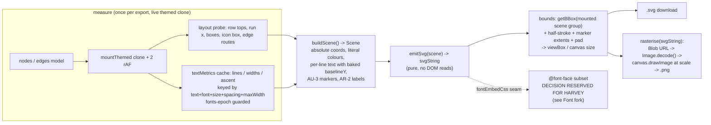

# ROUND AY — SVG-first export architecture (OPTION B)

Status: SPEC (architecture by the architect profile, task t_7558e447). Implementation is task
t_822ff5a3 (coder), one item per commit, in order. Nothing in this file has been executed.

Evidence base (read, not re-derived):
- `research/export-architecture-report.md` — target shape C1 (scene graph → per-shape serializer →
  thin backends), the five rules, the html-to-image root causes (all measured).
- `research/export-parity-market-study.md` — what Excalidraw/tldraw/draw.io/Penpot do; "pick one
  authoritative artifact and derive the other from it" ⇒ SVG-first, PNG = rasterise(SVG).
- `research/svg-text-typography-fidelity.md` — measured costs of text/subset/outline, the OFL/fsType
  licensing gates, and "stop deriving text geometry at export time".

Current state (verified this session, do not re-derive):
- `src/exportSvg.ts` — 1085 lines (≈419 code lines). Pure per-shape serializer with an INJECTED
  `SvgMeasurer`. Already emits literal colours for accents/strokes via `resolveVar(resolveColor(...), tokens)`,
  absolute coords via `absPosition`, the AU-3 marker contract, the AR-2 label storage (`e.label`),
  the AV icon lift, and the AX row model (`runs`/`baselineTops`, measured off the themed clone).
- `src/App.tsx:4224` `buildSvg` — thin wrapper: mounts themed clone, collects Export nodes/edges,
  resolves tokens, calls `exportSvg`. `App.tsx:4320` `buildPng` — still the DOM-clone path:
  themed clone → AU-1 chrome strip → AV fill fold → AV icon inline → BA whole-svg paint inline →
  `html-to-image` `toPng` (pinned 1.11.11), 15 s timeout, `backgroundColor`/`pixelRatio` options.
- `collectCss` (App.tsx:4190) is DEAD — defined, referenced only by a comment. Delete.
- Fonts: `src/styles.css:98-99` — `--mono: ui-monospace, SFMono-Regular, Menlo, Consolas, monospace`
  and `--sans: ui-sans-serif, system-ui, -apple-system, 'Segoe UI', Roboto, sans-serif`. System
  stacks: nothing embeddable (see §Font fork).
- `SEQUENCE_ENABLED = false` in `src/presets.ts:31`; the export path must keep working with it off.
- 53 harnesses in `checks/`; `client_js_bytes` ratchet ceiling 900,000 (measured 885,975 at HEAD).

---

## 0. The architecture in one paragraph

Today there are two exporters that each derive geometry: the SVG path re-measures the DOM and
re-derives text metrics; the PNG path clones the DOM and lets html-to-image re-derive everything
(patched per-round by AU/AV/BA inline passes). OPTION B collapses this to **one scene, one
serializer, two thin backends**: a `buildScene()` pass measures the LIVE themed clone once and
returns a fully-resolved Scene (absolute coordinates, literal colours, per-line text with baked
baseline `y`, no `var()`/`color-mix()`/`currentColor` anywhere), a pure emitter turns the Scene
into an SVG string, and PNG is `rasterise(svgString)` via `Image` → `canvas.drawImage`. Text
metrics (wrap decisions, widths, per-font ascent) move into a persisted module-level cache keyed
by every geometry input, so export REPLAYS measurements instead of re-deriving them.



### Settled design decisions (binding on the coder)

- D1 — The themed offscreen clone STAYS as the layout measurer. Nodes are DOM-laid-out (React Flow
  + CSS); row tops, run x, boxes, icon boxes and edge routes are live-layout TRUTH, not
  approximations, and cannot be derived from the model alone. What changes is that its outputs are
  captured ONCE into the Scene and never re-read downstream.
- D2 — Pure-text geometry (wrap lines, string widths, per-font ascent) moves to a persisted cache
  (`src/textMetrics.ts`). Key = (text, family, size, weight, spacing, maxWidth). Anything not in
  the key cannot affect the result, so a stale entry is structurally impossible — except for a late
  font load, handled by the fonts-epoch guard below.
- D3 — Colors are resolved at scene build only. The emitter writes literals; the token `<style>`
  block stays in the file (harmless, and other tooling reads it) but nothing painted depends on it.
- D4 — `emitSvg` is a pure function of `(Scene, ctx)`; it never touches `document`. This keeps the
  Node harness path (deterministic stub measurer) alive.
- D5 — PNG comes from the SVG string. After the flip there is exactly one painter per pixel class;
  the AU/AV/BA DOM-clone patch passes and the `html-to-image` dependency are deleted.

---

## 1. The persisted text-metrics cache — `src/textMetrics.ts` (NEW)

**What changes.** A module-level cache with a small API:

```
type TextMetricsKey = { text: string; family: string; size: number; weight: number; spacing: number; maxWidth: number };
type CachedMetrics = { lines: string[]; widths: number[]; ascent: number };
getTextMetrics(key, measure): CachedMetrics     // measure = injected width fn (hidden <svg><text>)
fontsEpoch(): number                            // bumped when document.fonts becomes 'loaded'
clearTextMetrics(): void                        // epoch bump = implicit clear
```

- The wrap uses the EXISTING pure `wrapText()` (exportSvg.ts:536) with the injected width fn, so
  the wrap decision is byte-identical to today on day one. The cache just stops re-measuring.
- `ascent` (today `ascentOf`, canvas `measureText('Mg').fontBoundingBoxAscent`) is cached keyed by
  (family, size, weight) — it is a pure font property.
- **Fonts-epoch guard (the failure mode, stated explicitly):** every cache entry records the epoch
  it was measured under. On `document.fonts.addEventListener('loadingdone' | 'loadingerror')` (and
  once at boot if `document.fonts.status === 'loaded'`), the epoch increments and all entries from
  older epochs are discarded. Rule: **a stale measurement is worse than a slow one** — on any doubt
  (fonts not yet `loaded` at scene-build time) we AWAIT `document.fonts.ready` (bounded: race
  against a 2 s timeout, then measure anyway under the current epoch) rather than serve metrics
  measured in a fallback face. Today's system stacks resolve instantly and the guard is a no-op;
  it exists so Route 1 of the font fork (shipped fonts) cannot ship stale geometry later.
- Zoom/theme do NOT invalidate: the key is in px at the row's own font-size (zoom-independent) and
  colours are not geometry. Edits and resizes invalidate structurally: they change `text` or
  `maxWidth`, i.e. the key.

**Files.** NEW `src/textMetrics.ts`; `src/exportSvg.ts` (`ascentOf` and the `widthOf` plumbing move
out or re-export); `src/App.tsx` `domMeasurer` keeps supplying the raw width fn.

**Proof (probe board, new harness `checks/round-ay-text-cache.mjs`).**
1. RED first: on the pre-change tree, a stub-measurer double-export does not hit any cache (there
   is none) — assert the new module's hit counter > 0 on second export of an unchanged board.
2. Same board exported twice without edits: wrap decisions identical (compare emitted `<text>` line
   contents — must be equal element-wise).
3. Edit one title, re-export: only that node's lines change; other nodes' emitted text bytes
   identical (cache hit, not re-derivation).
4. Determinism: `sha256(svgA) === sha256(svgB)` for two exports of the unchanged probe board.

**Out of scope.** Persisting metrics into `boards/*.json` (node data) — the module cache covers the
export path; writing geometry into saved boards changes the file format and is a different card.
No canvas-render-time use of the cache (the DOM lays out the canvas; it does not need our cache).

---

## 2. `buildScene()` — the resolved scene — `src/exportScene.ts` (NEW) + `exportSvg.ts` refactor

**What changes.** One function turns `(nodes, edges, theme, tokens, measurer)` into a Scene:

```
type SceneTextRow = { x: number; baselineY: number; content: string;
  size: number; weight: number; fill: string; family?: string; spacing?: number; anchor?: string };
type SceneNode = { id: string; absX: number; absY: number; w: number; h: number; kind: string;
  frame?: string;            // pre-serialized shape-frame markup, literal colours
  icon?: IconMeasure;        // AV lift, resolved ink
  rows: SceneTextRow[];      // per-line, baselineY = AX top + cached ascent, baked
  rawSvg?: string };         // customshape: the user SVG string, verbatim
type SceneEdge = { id: string; d: string; color: string; strokeWidth: number;
  marker: { w: number; h: number }; label?: { x: number; y: number; row: SceneTextRow } };
type Scene = { theme: string; bg: string; nodes: SceneNode[]; edges: SceneEdge[]; bounds: Bounds };
```

- `buildScene` runs the measurer passes that today live inside `exportSvg` (text rect, rows fonts,
  run x, baselineTops, icon, edgePath, edgeLabelFont), resolves every colour through the existing
  `resolveVar`/`resolveColor`/`tokens` chain, resolves positions through `absPosition`, and bakes
  each row's `baselineY = measuredTop + cachedAscent(family,size,weight)` and each line's wrap from
  the §1 cache. After this point **nothing downstream reads the DOM or CSS**.
- `exportSvg.ts` becomes `emitSvg(scene, ctx)` — the same markup emitters (shapeFrameSvg, iconMarkup,
  tableMarkup, noteMarkup, edge label box, AU-3 `markerId`) fed from the Scene instead of from
  measurer callbacks. The existing `exportSvg(input)` signature can remain as a thin
  compose(buildScene + emitSvg) so the 10+ harnesses that import it keep compiling.
- `ctx` gains the font seam: `fontEmbedCss?: string` — when present, emitted verbatim inside
  `<defs><style>`. Empty for now; see Font fork.

**Files.** NEW `src/exportScene.ts`; `src/exportSvg.ts` (refactor to emitter-of-scene, keep exports);
`src/App.tsx` `buildSvg` (call compose; no behavioural change intended).

**Proof (new harness `checks/round-ay-scene.mjs`, plus re-run of the whole existing export family:
round-ar-svg-export, round-ar2-export-fidelity, round-au-export-parity, round-av-colour-parity,
round-ar-font-parity).**
1. Scene purity: grep-assert the emitted svgString contains no `var(`, no `color-mix(`, no
   `currentColor` (RED on today's tree: the token `<style>` block carries `var()`-free literals
   already, but at least `currentColor` appears in paths lifted verbatim from lucide — measure and
   list every occurrence found, then assert zero after the scene resolves icon ink).
2. Byte-parity gate: export the probe board before and after this refactor — the picture must be
   unchanged; any byte diff must be enumerated and justified (expected: none, or only attribute
   order). Report the diff.
3. Determinism (re-assert): double-export sha256 equality.
4. All existing export harnesses green, re-run BY HAND (not only via the sweep).

**Out of scope.** Moving the themed-clone mount out of App.tsx (it can stay a callback); changing
any painted value; sequence-diagram presets beyond keeping them exporting under
`SEQUENCE_ENABLED=false`.

---

## 3. Bounds from `getBBox()` + stroke + markers + pad

**What changes.** Today the viewBox comes from `node.width/height` boxes (exportSvg.ts:840-852).
Replace with: parse the emitted content group, mount it hidden in the document
(`position:fixed; visibility:hidden` — detached nodes have no layout, per the measured
`getComputedStyle`-on-detached result in the architecture report), and compute:

```
bounds = union( getBBox(contentGroup),                 // nodes, frames, text rows, edge paths, label boxes
                per-edge marker extent boxes,          // analytic: marker w/h × strokeWidth (markerUnits="strokeWidth"), at the route's end tangent
                + half max stroke width )              // 0.9 px at stroke 1.8
viewBox/canvas = bounds inflated by pad (pngPad)
```

- Markers are NOT part of `getBBox` (they are not path geometry) — hence the analytic union, using
  the SAME numbers the AU-3 marker contract already emits (markerEnd w/h, `markerUnits="strokeWidth"`).
- Edge labels: already painted elements inside the group ⇒ included by `getBBox` automatically.
- Group children: painted via the group frame rect ⇒ included; additionally the group frame's own
  ±12 px inflation stays as-is (it is painted geometry).
- The stub/harness path (no DOM) keeps a deterministic fallback: the current node-box arithmetic,
  marked `boundsSource: 'boxes'` vs `'bbox'` on the scene so the harness can assert which ran.
- Text must be measured AFTER fonts settle — §1's await is part of this path; `getBBox` on the
  mounted group runs after it.

**Files.** `src/exportScene.ts` (bounds step); `src/exportSvg.ts` (viewBox from scene bounds);
harness.

**Proof (new harness `checks/round-ay-bounds.mjs`, plus a live probe).**
1. RED on the pre-change tree: a probe board with a horizontal edge whose arrowhead lands at the
   extreme right shows the marker extending BEYOND the current content-box-derived viewBox edge
   (measure the marker extent vs `viewBox.width` — assert markerRight > viewBox edge on the old
   arithmetic; assert contained after).
2. A rotated/long edge label probe: label rect fully inside the new viewBox (assert via the
   emitted `x/width` numbers), no clipping at 1× and 2× PNG.
3. Empty-ish board (1 node) still exports with sane pad (no Infinity/NaN in width/height attrs —
   assert numeric).

**Out of scope.** Trim-to-ink ("crop to content" tighter than boxes) — getBBox of the whole group
already unions painted geometry; per-node ink trimming changes the exported crop and is not asked
for.

---

## 4. PNG = `rasterise(svgString)` — `src/exportPng.ts` (NEW), `buildPng` flip

**What changes.** New pure-ish module:

```
rasterise(svg: string, o: { scale: number }): Promise<string>   // dataURL
  1. const url = URL.createObjectURL(new Blob([svg], {type:'image/svg+xml'}))
  2. img.decoding='async'; img.src=url; await img.decode()      (race a 15 s timeout like today)
  3. canvas.width = ceil(svgWidth*scale); canvas.height = ceil(svgHeight*scale)
  4. ctx.imageSmoothingEnabled = true; drawImage(img, 0,0, canvas.width, canvas.height)
  5. revokeObjectURL; return canvas.toDataURL('image/png')
```

- `svgWidth/Height` read from the root `<svg width height>` (present since AR) — after §3 those
  numbers ARE the getBBox+pad bounds.
- **Scale/pixelRatio:** `pngScale` (existing pref, default 2) multiplies the canvas exactly as
  `pixelRatio` did for html-to-image. No 16384 silent clamp of html-to-image's — instead an
  explicit guard: if `canvas.width|height > 16384`, fail the export with a visible error (never
  silently rescale).
- **Theme background:** the emitted SVG already paints `<rect width height fill=--bg-literal/>`
  first; the canvas is additionally pre-filled with the same resolved token (belt-and-braces for
  any codec that drops the rect).
- **buildPng becomes:** `const svg = await buildSvg(o); return rasterise(svg, {scale: pngScale})`.
  The themed clone, AU-1 chrome strip, AV fill fold, AV icon inline, BA paint walk, `getNodesBounds`
  transform juggling, and the `toPng` call are DELETED from buildPng. Chrome cannot appear because
  the scene never contains editor affordances — that is the structural replacement for AU-1.
- **Custom imported shapes:** they are user SVG strings ALREADY inlined verbatim into the emitted
  file (exportSvg.ts:1009-1015, scaled into the node box) — they survive this path BY
  CONSTRUCTION (they are part of the svgString). One caveat to document, not fix: user SVG that
  references EXTERNAL hrefs (images/fonts by URL) will not load inside an ``-context SVG
  (SVG secure static mode, no external references — see the typography report §1.7). Such refs do
  not paint today either under html-to-image's data-URL serialization; behaviour parity, documented.
- Blob URL (not base64 data URL) keeps the string unicode-safe and avoids the 33 % bloat.

**Files.** NEW `src/exportPng.ts`; `src/App.tsx` `buildPng` rewrite (net deletion); harness.

**Proof (the child card's hard gate, in this order).**
1. BEFORE the flip, capture the current PNG output for the standard probe board at 2×, both
   themes, and a custom-shape board — committed under `checks/fixtures/` (or scratch, coder's
   call, but the capture must be reproducible).
2. After the flip, rasterise the same boards and pixel-diff old vs new: report
   `changedPx / totalPx` and WHERE (bounding boxes of diff clusters). A large unexplained diff is
   a failure. EXPECTED small, explainable diffs: text rasterised through the SVG engine vs
   html-to-image's foreignObject clone (baseline/hinting policy, ~1 px ink edges — same class as
   the measured 2.6 %/1 px floor in the typography report §7.3); everything else should be 0.
3. Edge + marker pixels > 0 in both themes (the BA assertion, now structural).
4. Selection chrome: with a node selected in the live editor, exported PNG contains 0 px within
   ±40 of `--sel` (AU-1's assertion, re-proven on the new path).
5. Timeout behaviour: a poisoned svg string rejects within the 15 s bound (harness stub).
6. Oversize guard: a fake 20000-px-wide scene rejects with the visible error, no silent rescale.

**Out of scope.** JPEG/WebP (trivial follow-up once PNG lands); a progress UI; server-side escape
hatch for exotic CSS (no node class uses backdrop-filter/blend modes today — verify with a grep as
part of the item and record the result).

---

## 5. Demolition — delete the DOM-clone PNG machinery

**What changes.** After item 4 is green: remove `html-to-image` from `package.json` and the
`toPng` import; delete `collectCss` (dead, verified); prune the now-unreachable clone-patch code
paths (AU-1 strip list, AV fill fold, AV icon inline walk, BA paint walk) from App.tsx; retire
harness `round-ba-svg-inline-paint.mjs` (it asserts html-to-image-era clone behaviour — replace its
still-meaningful assertions [edge pixels, tint, icon ink] with the item-4 rasterise equivalents if
not already covered). `mountThemed` STAYS (scene measurement scaffold for buildSvg).

**Files.** `src/App.tsx` (net deletion), `package.json`, `checks/round-ba-svg-inline-paint.mjs`,
`.gob` gate list if it enumerates the harness.

**Proof.**
1. `grep -rn "html-to-image" src/ package.json` → 0 hits.
2. Full gates: `npx tsc --noEmit` 0, `npx vite build` 0, full harness sweep green (each touched
   harness re-run by hand).
3. `client_js_bytes` before/after — report the number against the 900,000 ceiling. Expected: a
   DROP (html-to-image leaves the bundle). If bytes drop by more than 2 %, the ratchet policy says
   ASK — a large drop can mean deleted code; here the deletion is intentional and enumerated, so
   report it and re-baseline per policy at Harvey's milestone call.

**Out of scope.** Removing `mountThemed`; touching the export modal UI; anything in `boards/`.

---

## 6. Font-embedding decision fork — REPORT ONLY (reserved for Harvey)

**Not implemented.** The app's stacks are `ui-monospace…` / `ui-sans-serif…` — SYSTEM fonts.
Per the typography report (§6: OFL FAQ 1.11–1.13, OpenType `fsType`), system/retail fonts usually
may NOT be embedded; SVG 1.1 §20.2 makes embedded fonts display-only regardless. The two lawful
routes:

- **Route 1 — ship OFL fonts (e.g. Inter + JetBrains Mono), subset + embed as base64 WOFF2
  `@font-face` inside `<defs><style>` (the `ctx.fontEmbedCss` seam from item 2).**
  Cost, measured on our 744-char harness corpus: ≈ +8.8 KB WOFF2 per family+weight (63 glyphs,
  ~140 B/unique glyph; whole-file 6.0 KB → 16.8 KB). Two families × 2 weights ≈ +35 KB per export.
  Visual cost: the app's ENTIRE look changes (canvas + export) — every label reflows; the AX row
  model's measured geometry adapts automatically, but the aesthetic is Harvey's call, not ours.
  Benefit: cross-machine glyph parity, the single highest-value change for export fidelity.
- **Route 2 — ship nothing; keep `font-family` stacks in the file and accept substitution.**
  Cost: 0 bytes, 0 visual change; a viewer without the matching system font substitutes
  (measured on our harness: +2.4 %/+3.8 % line-width drift, 6.3 % pixel diff). Optional cheap
  hardening under this route: per-line `textLength` width locks (measured widths from the §1
  cache) so substituted text occupies the authored width — note the SVG 1.1 caveat that
  intermediate glyph placement is explicitly unpredictable, and do NOT combine with any wrapping.

**What the coder does in this item:** implement nothing beyond the already-present seam; produce a
short measured annex on the probe board (label ink widths under both routes' assumptions, file
sizes) and post it on the card. **Harvey decides.** Route 1 additionally requires the licence
allow-list guard from the typography report §6 (refuse to embed unless OFL/Apache or fsType
permits) — only if Route 1 is chosen.

---

## What stays / moves / is deleted

| Piece | Verdict | Why |
|---|---|---|
| AU-1 chrome sanitiser (clone strip list) | DELETED at item 4/5 | Structural: the scene cannot contain editor chrome; AU-1's assertions move to the rasterise path (item 4, proof 4) |
| AU-2 forwarded edge element (`e.el` → measured route) | KEPT, feeds `buildScene` | The clone's live path is the only real route source (bends included) |
| AU-3 marker contract (markerEnd w/h verbatim, `markerUnits="strokeWidth"`, closed polyline) | KEPT, moves into Scene + bounds | Same numbers now also drive the analytic marker extents (item 3) |
| AX row model (`runs` x / `baselineTops`) | KEPT, MOVES into `buildScene`; `ascentOf` moves into the §1 cache | It is the measured-row truth; the cache makes the ascent half persistent |
| AR-2 label storage (`e.label` only) | KEPT | Single source, already correct |
| AV icon lift | KEPT, moves into Scene (`icon` field, resolved ink) | Already scene-shaped |
| AR-10/11 wrap width + per-row families | KEPT, wrap now served from the §1 cache | Same decisions, measured once |
| `wrapText`, `absPosition`, `shapeFrameSvg`, `markerId`, `tableMarkup`, `noteMarkup` | KEPT (emitSvg) | Pure emitters, unchanged behaviour |
| `mountThemed` + 2 rAF | KEPT | Layout measurer (D1) |
| `collectCss` | DELETED (item 5) | Dead code — verified: defined App.tsx:4190, zero call sites |
| html-to-image dep + `toPng` | DELETED (item 5) | Replaced by `rasterise` |
| `round-ba-svg-inline-paint.mjs` | RETIRED (item 5) | Asserts the deleted clone path; live assertions re-homed to item 4 |
| All other 52 harnesses | KEPT, must stay green | Regression net |
| `pngScale`/`pngPad` prefs | KEPT | Same semantics (scale multiplier, inflate-by pad) |

## Risk register

| Risk | Likelihood | Verification |
|---|---|---|
| Custom shapes (user SVG) break in `` context | Low (inlined verbatim already) | Item 4 proof: custom-shape probe board in the pixel-diff set; external-href limitation documented |
| Note nodes / table nodes / group frames regress | Medium (refactor touches their emit path) | Re-run round-ar2-export-fidelity, round-av-colour-parity by hand; scene rows asserted per kind |
| Edge labels drift | Low (labelAnchor untouched) | round-au-export-parity + item 3 proof 2 |
| Sequence diagrams (hidden flag) | Low (no path branches on it in export) | grep `SEQUENCE_ENABLED` in export paths; export probe with a sequence board JSON hand-built if the preset exists in code |
| Mermaid round-trip | None expected (import path untouched) | round-as-mermaid re-run |
| `SEQUENCE_ENABLED=false` path | Certain-to-be-exercised (it IS the current path) | All probes run under the flag as-is |
| PNG pixel diff larger than explained | Medium (the honest risk) | Item 4 proof 2's cluster analysis; any unexplained cluster BLOCKS, per the child card |
| getBBox needs mounted, font-settled DOM | Certain (measured in the reports) | §1 fonts await + hidden mount in the same rAF cadence as mountThemed |
| Text rasterises differently via SVG engine vs foreignObject clone | Certain, bounded (~1 px ink / low single-digit % pixels) | Reported as a number, not chased; the typography report's measured 2.6 %/1 px floor is the reference |
| Bundle bytes grow mid-round (new modules) | Low; net DOWN at item 5 | Report `client_js_bytes` every commit against 900,000 |

## Gates (every commit)

`npx tsc --noEmit` 0 · `npx vite build` 0 · full harness sweep green, touched harnesses re-run by
hand · `client_js_bytes` reported · each new assertion proven RED on the pre-change tree · probe
boards only (unique names, no writes to `boards/mvaf8pkt162b2aed.json`, no DELETE on the boards
API) · LOCAL only, no push.
