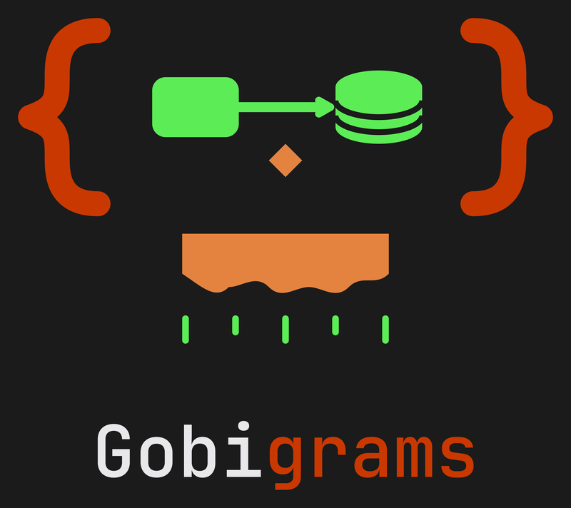

<p align="center">
  <a href="https://gobigrams.tech-goblin.com">
    
  </a>
</p>

<h1 align="center">Gobigrams for Obsidian</h1>

<p align="center">
  <b>Diagrams, but with a goblin — inside your vault.</b><br/>
  Write a <code>gobi</code> code block, get a real diagram, themed by your vault. Render only, like Mermaid.
</p>

<p align="center">
  
  
  
  <a href="https://github.com/harveynguyen33/gobigrams/blob/main/LICENSE"></a>
</p>

<p align="center">
  <a href="https://gobigrams.tech-goblin.com"><b>Website</b></a> ·
  <a href="#when-you-want-this">Use cases</a> ·
  <a href="#install">Install</a> ·
  <a href="#what-it-does">What it does</a> ·
  <a href="https://github.com/harveynguyen33/gobigrams/tree/main/packages/gobi">Core package</a> ·
  <a href="https://buymeacoffee.com/harveynguyen33">☕ Buy me a coffee</a>
</p>

---

## When you want this

### 1. A note that explains a system, with the diagram next to the words

````markdown
## Checkout flow

```gobi
board "Checkout"
direction LR
cf  = external "Cloudflare"
api = service  "Checkout API"  color:red
q   = queue    "payments"
db  = database "orders"
cf -> api "HTTPS"
api -> q  "publish"
q   -> db "persist"
```

The queue is the only thing that touches the database, so a payment retry never
holds an HTTP connection open.
````

The block renders inline, in reading view **and** live preview.

### 2. Diagrams your vault can diff

A `.gobi` block is text. Move a node, rename a service, change an arrow — the change shows up in your vault's
git history as a line of text, not as a replaced binary blob. That is the reason this plugin exists instead of
"paste a PNG": diagrams that live in the note, not beside it.

### 3. Diagrams that belong to the vault's theme

Colours are resolved at render time from Obsidian's own CSS variables (`--background-primary`,
`--text-normal`, `--interactive-accent`, …). The same note looks right in a light vault and a dark one, and a
block re-renders when you switch themes — no second copy of the diagram, no "light version" folder.

### 4. Documentation for a project you also render elsewhere

The plugin bundles the **same core** as the Gobigrams web app, the CLI and the MCP server. The SVG in your
vault is byte-identical to what the app would export from the same text — the 24-fixture corpus proves it on
every build.

## What it does

- **Renders ` ```gobi `** in reading view and live preview, through one compile → one layout → one drawing
  path (`@techgoblin/gobi-core`). No second implementation lives in this plugin.
- **Shows every error, styled** — line, column, message and the suggestion where there is one. Nothing is
  swallowed, and a broken block never breaks the note.
- **Follows your theme** — vault CSS variables mapped onto the diagram's tokens.
- **Measures text with the core's committed table** — the same numbers every other surface uses.

## What it does NOT do

- No canvas editing inside Obsidian (dragging, connecting, resizing).
- No sync-back from a diagram to the `.gobi` text.
- No file export from the plugin — use the [Gobigrams app](https://gobigrams.tech-goblin.com) or the CLI.
- No settings: the theme follows the vault.

## Install

### From a release (BRAT)

1. Install [BRAT](https://github.com/TfTHacker/obsidian42-brat) from the community store.
2. BRAT → **Add Beta plugin** → paste
   `https://github.com/harveynguyen33/gobigrams-obsidian` (the distribution repo carrying
   `manifest.json`, `main.js` and `styles.css` at its root).
3. Enable **Gobigrams** in Settings → Community plugins.
4. Paste a ` ```gobi ` block into any note and switch to reading view.

The distribution repo is a RELEASE CHANNEL, not a fork: it is generated from this tree by
`scripts/publishObsidian.mjs`, which refuses to publish a bundle whose `gobi-core:<version> <sha>`
stamp disagrees with the core in the workspace.

### From source

```sh
cd apps/obsidian-gobi
npm run build   # type-checks, bundles core+plugin into main.js, enforces the 1.5 MB budget
npm test        # corpus: 24 good fixtures byte-match the committed goldens; error path; theme bridge
```

Copy `main.js`, `manifest.json` and `styles.css` into `<vault>/.obsidian/plugins/gobi/` and enable the plugin.

## Layout

| file | role |
|---|---|
| `src/main.ts` | the Obsidian plugin: one `registerMarkdownCodeBlockProcessor("gobi", …)` |
| `src/render.ts` | the render entry: `compileGobi` + `renderGobiDocument` + the committed metric table |
| `src/obsidianTheme.ts` | the theme bridge: Obsidian CSS variables → gobi tokens |
| `scripts/build.mjs` | esbuild bundle (core bundled in, `obsidian` external) + version handshake + size budget |
| `test/corpus.mjs` | the acceptance test — drives the BUILT `main.js` against the shared corpus |

## Version handshake

`main.js` embeds `gobi-core:<version> <sha>` at build time, taken from the workspace `packages/gobi/package.json`.
The build fails if that version disagrees with the core in the tree, so a stale bundle cannot ship.

---

<p align="center">
  <b>Built by <a href="https://github.com/harveynguyen33">Harvey Nguyen</a></b><br/>
  MIT licensed — use it, fork it, ship it.<br/><br/>
  Gobigrams is free: no account, no ads, no tracking worth the name.<br/>
  If it saved you an afternoon of dragging boxes:
  <a href="https://buymeacoffee.com/harveynguyen33"><b>☕ buy the goblin a coffee</b></a>
</p>
