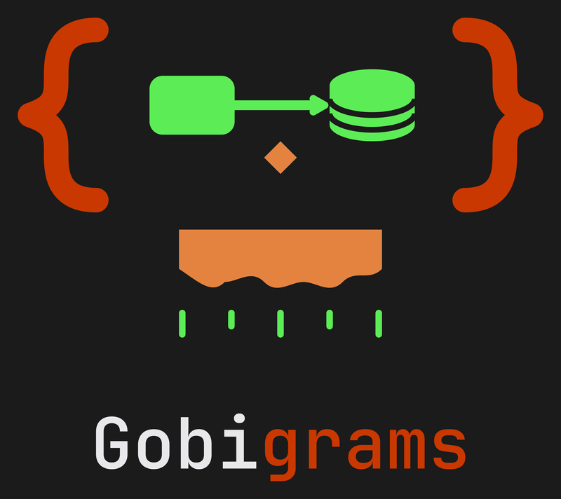

<p align="center">
  <a href="https://gobigrams.tech-goblin.com">
    
  </a>
</p>

<h1 align="center">@techgoblin/gobi-mcp</h1>

<p align="center">
  <b>Diagrams, but with a goblin — for your AI agent.</b><br/>
  An <a href="https://modelcontextprotocol.io">MCP</a> server that lets any agent draw real diagrams:
  no browser, no token, no port, no screenshot.
</p>

<p align="center">
  
  
  
  <a href="https://github.com/harveynguyen33/gobigrams/blob/main/LICENSE"></a>
</p>

<p align="center">
  <a href="https://gobigrams.tech-goblin.com"><b>Website</b></a> ·
  <a href="#when-you-want-this">Use cases</a> ·
  <a href="#install">Install</a> ·
  <a href="#the-four-tools">Tools</a> ·
  <a href="https://github.com/harveynguyen33/gobigrams/tree/main/packages/gobi">Core package</a> ·
  <a href="https://buymeacoffee.com/harveynguyen33">☕ Buy me a coffee</a>
</p>

---

## What this is

A **stdio** MCP server over [`@techgoblin/gobi-core`](https://github.com/harveynguyen33/gobigrams/tree/main/packages/gobi).
It runs as a child process of your client, speaks JSON-RPC on stdin/stdout, and exposes four tools. It carries
**no logic of its own** — every parse, validation, layout and drawing decision belongs to the core, which is
the same core the editor app renders with. So the SVG your agent produces is byte-identical to the one a human
would export from the app.

## When you want this

### 1. "Draw me the flow we just discussed" — in the conversation

You are in Claude Code / Cursor / Hermes talking through an architecture. Instead of describing boxes in
ASCII, the agent calls `gobi_render` and you get a real SVG you can save, open or commit.

```
you    → design the checkout flow: cloudflare, checkout api, payments queue, orders db
agent  → gobi_render { text: "board \"Checkout\"\n..." }
agent  ← { ok: true, svg: "<svg …>" }
```

### 2. The agent fixes its own mistakes in ONE round

The tool returns **every** error at once, with `line`, `column`, `message` and often a `suggestion`. A model
does not page through errors one at a time, and does not guess what the renderer wanted.

```
agent  → gobi_validate { text: "board x\na = servce \"A\"" }
agent  ← { ok: false, errors: [
            { line: 2, column: 5, message: "\"servce\" is not a node kind",
              suggestion: "did you mean service?" } ] }
agent  → gobi_validate { text: "board x\na = service \"A\"" }      ← one repair
agent  ← { ok: true }
```

### 3. Documentation generated by an agent, diagrams included

An agent reads a repo, writes one `.gobi` per subsystem, renders each, and commits the SVG into docs. No
screenshots, no image generation, no layout guesswork — the output is deterministic text-to-vector.

### 4. A picture for a chat or an issue

`gobi_png` returns a real PNG as an MCP **image content block** (`mimeType: "image/png"`), so image-capable
clients show the diagram and the token cost is image tokens — not tens of thousands of base64 characters in
the text context. A small text block alongside carries the facts only:
`{ "ok": true, "bytes": 26436, "width": 1000, "height": 388, "scale": 2 }`. If the rasteriser is
unavailable in that environment it says so and **still returns the SVG**, rather than failing:

```jsonc
{ "ok": false, "reason": "rasteriser unavailable", "svg": "<svg …>" }
```

### 5. Edit an existing diagram instead of rewriting it

`gobi_describe` returns a compact, model-readable summary — node ids, kinds, labels, edges, groups — so the
agent reads the structure first and changes only what you asked for.

## The four tools

| Tool | Input | Output | Notes |
|---|---|---|---|
| `gobi_validate` | `{ text }` | `{ ok, errors: [{line, column, message, suggestion?}], doc? }` | **every** error in one response |
| `gobi_render` | `{ text, theme? }` | `{ ok, svg }` or `{ ok: false, errors }` | themes: `dark` `light` `paper` `midnight` `contrast` |
| `gobi_png` | `{ text, theme?, scale? 1-4 }` | image block + `{ ok, bytes, width, height, scale }` or `{ ok: false, reason, svg }` | degrades to SVG, never throws |
| `gobi_describe` | `{ text }` | compact document summary | ids, kinds, labels, edges, groups |

Plus one MCP **prompt**, `write-gobi`, which encodes the intended loop so a model does not have to be told:
*write the source → validate until ok → render → describe before rewriting*.

## Install

**Add to a client config** — once published, no path is needed:

```json
{ "mcpServers": { "gobi": { "command": "npx", "args": ["-y", "@techgoblin/gobi-mcp"] } } }
```

Before the package is published, point at the built server in a local checkout (replace `<checkout>` with the
absolute path of your clone):

```json
{ "mcpServers": { "gobi": { "command": "node",
  "args": ["<checkout>/packages/gobi-mcp/dist/server.mjs"] } } }
```

From source:

```bash
git clone https://github.com/harveynguyen33/gobigrams
cd gobigrams && npm install
npm run build -w @techgoblin/gobi-mcp
npm test    -w @techgoblin/gobi-mcp    # drives the built server over the real stdio protocol
```

**Worked example** — `gobi_validate {"text": "board Demo\nsvc -> db"}` returns every error at once; fix them,
then `gobi_render` returns `{ok, svg}`.

## Design rules this server follows

1. **stdio only** — one process per client: no port, no auth token, no daemon, nothing to expose.
2. **Zero logic in the adapter** — it parses JSON, calls the core, returns JSON. If a rule needs to change it
   changes in the core, once, with a corpus assertion.
3. **Logs go to stderr** — stdout is the protocol. A stray `console.log` corrupts framing.
4. **Degrade explicitly** — a missing optional capability returns `{ok: false, reason, …}` with the best
   partial payload, never a thrown error and never a silent downgrade.
5. **The corpus proves it** — all 24 fixtures render byte-identically through the server, compared against
   hashes committed by the core package. Two doors over one core is the whole point.

## Trust boundary

The server does not read your filesystem, does not open sockets, and does not fetch anything. It takes a
string and returns a string. The only thing it can do is draw.

**Input bound** — every tool's `text` argument is capped at **100,000 characters**. The largest realistic
board we could construct (156 nodes, runbook-length notes, 250 labelled edges) measures ~17 KB, so the cap
sits ~6x above it; an over-limit input is refused by the tool schema with a message naming the limit,
before it ever reaches the compiler.

---

<p align="center">
  <b>Built by <a href="https://github.com/harveynguyen33">Harvey Nguyen</a></b><br/>
  MIT licensed — use it, fork it, ship it.<br/><br/>
  Gobigrams is free: no account, no ads, no tracking worth the name.<br/>
  If it saved you an afternoon of dragging boxes:
  <a href="https://buymeacoffee.com/harveynguyen33"><b>☕ buy the goblin a coffee</b></a>
</p>
