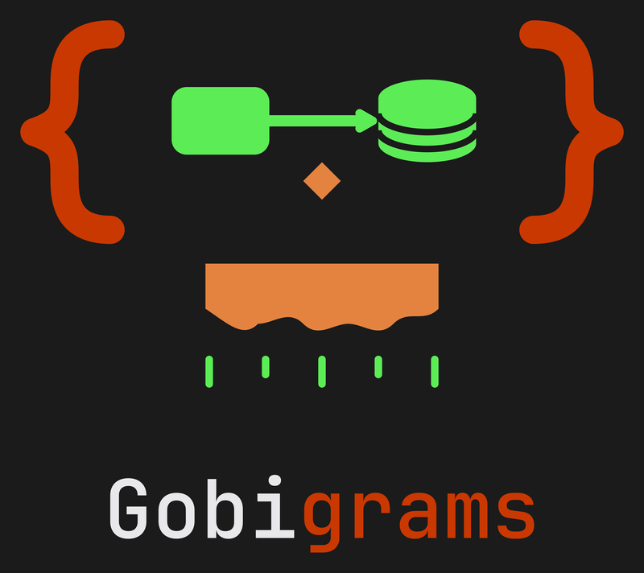
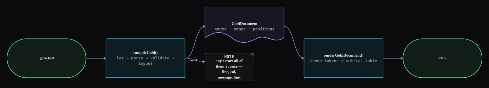

<p align="center">
  <a href="https://gobigrams.tech-goblin.com">
    
  </a>
</p>

<h1 align="center">@techgoblin/gobi-core</h1>

<p align="center">
  <b>Diagrams, but with a goblin.</b><br/>
  The <code>.gobi</code> diagram language — write a diagram as text, get a real SVG, with
  <b>no browser, no React, no canvas</b>.
</p>

<p align="center">
  <a href="https://www.npmjs.com/package/@techgoblin/gobi-core"></a>
  <a href="https://www.npmjs.com/package/@techgoblin/gobi-core"></a>
  
  
  <a href="https://github.com/harveynguyen33/gobigrams/blob/main/LICENSE"></a>
</p>

<p align="center">
  <a href="https://gobigrams.tech-goblin.com"><b>Website</b></a> ·
  <a href="#when-you-want-this">Use cases</a> ·
  <a href="#the-whole-api-in-five-lines">Quickstart</a> ·
  <a href="#the-language-in-one-block">The language</a> ·
  <a href="#one-core-six-doors">One core, six doors</a> ·
  <a href="https://github.com/harveynguyen33/gobigrams/issues">Issues</a> ·
  <a href="https://buymeacoffee.com/harveynguyen33">☕ Buy me a coffee</a>
</p>

---

## What this package actually is

Two functions and the inputs they need. **This diagram is rendered by the package itself** from the
`.gobi` source underneath it — dogfooding, in the same dark theme the editor ships:

<p align="center">
  
</p>

```gobi
board "gobi-core: text to SVG"
direction LR

src_  = terminator ".gobi text"
comp  = process    "compileGobi()"          sub:"lex → parse → validate → layout"
json  = document   "GobiDocument"           sub:"nodes · edges · positions"
rend  = process    "renderGobiDocument()"   sub:"theme tokens + metrics table"
out   = terminator "SVG"
bad   = note       "any error: all of them at once — line, col, message, hint"

src_ -> comp
comp -> json
json -> rend
rend -> out
comp ..> bad   "not ok"
```

Everything else in the package exists so those two calls work with **zero** dependencies and **zero**
environment assumptions. It is not a UI library, it does not draw on a canvas, and it does not need a DOM.

This is the **same compiler and the same emitter** the [Gobigrams editor](https://gobigrams.tech-goblin.com)
ships, and the byte parity is pinned by a 24-fixture corpus that travels with the package — so the SVG you
generate in a build script is byte-identical to the one the app exports.

## When you want this

Pick the row that sounds like your problem.

### 1. Diagrams in a docs site, rendered at build time (no client JS)

You keep `.gobi` files next to your markdown, and the build turns them into `.svg` files you `` or
inline. Readers get a vector diagram with selectable text, your bundle gets nothing.

```js
// scripts/build-diagrams.mjs
import {readFileSync, writeFileSync, mkdirSync} from 'node:fs';
import {compileGobi, renderGobiDocument, tokensFromCss, tableMeasurer,
        EXPORT_TOKENS, THEME_CSS, DEFAULT_METRICS} from '@techgoblin/gobi-core';

mkdirSync('public/diagrams', {recursive: true});
for (const name of ['checkout-flow', 'data-model']) {
  const res = compileGobi(readFileSync(`diagrams/${name}.gobi`, 'utf8'));
  if (!res.ok) {
    console.error(name, res.errors);       // every error, in one go
    process.exit(1);                        // a broken diagram fails the build, not the page
  }
  writeFileSync(`public/diagrams/${name}.svg`, renderGobiDocument(res.doc, {
    theme: 'dark',
    tokens: tokensFromCss(THEME_CSS, 'dark', EXPORT_TOKENS),
    measureText: tableMeasurer(DEFAULT_METRICS),
  }));
}
```

`node scripts/build-diagrams.mjs` in your `prebuild` step. Same file, same bytes, every run.

### 2. Diagram-as-code in a repo: the diagram lives with the code it describes

Put `architecture.gobi` next to `src/`, review it in a pull request like any other text file, and render it
in CI. A diff of a `.gobi` file tells you what changed in the architecture; a diff of a `.png` tells you
nothing.

```js
// fail CI when a diagram no longer compiles
const res = compileGobi(readFileSync('docs/architecture.gobi', 'utf8'));
if (!res.ok) throw new Error(res.errors.map(e => `${e.line}:${e.col} ${e.message}`).join('\n'));
```

### 3. Let an AI agent draw the diagram

An agent writes `.gobi` (it is small and closed-world, so a model can hold it), calls `compileGobi`, and
**fixes everything in one round** because the errors come back together:

```js
let res = compileGobi(await askModel(prompt));
while (!res.ok) res = compileGobi(await askModel(prompt, res.errors));   // one repair round
const svg = renderGobiDocument(res.doc, {theme: 'dark', tokens, measureText});
```

If you would rather the agent did this by itself, use the ready-made door:
[`@techgoblin/gobi-mcp`](https://github.com/harveynguyen33/gobigrams/tree/main/packages/gobi-mcp) exposes
exactly this loop as `gobi_validate` → `gobi_render`.

### 4. A server that returns SVG (or PNG) from an API

No headless browser, no `canvas` native module, no memory spike per request: it is string in, string out.

```js
app.post('/diagram', (req, res) => {
  const r = compileGobi(req.body.gobi);
  if (!r.ok) return res.status(400).json({errors: r.errors});
  res.type('image/svg+xml').send(renderGobiDocument(r.doc, {
    theme: req.body.theme ?? 'dark',
    tokens: tokensFromCss(THEME_CSS, req.body.theme ?? 'dark', EXPORT_TOKENS),
    measureText: tableMeasurer(DEFAULT_METRICS),
  }));
});
```

### 5. Social cards / OG images with a real diagram on them

Render the SVG, rasterise it once at build time with whatever tool you already use, and put it on the card.
The renderer is deterministic, so the card image does not churn between builds.

### 6. Your own diagram app, without adopting a canvas library

`compileGobi` returns a **surface-neutral** `GobiDocument` — nodes with ids, kinds, labels and resolved
positions; edges with endpoints and labels. Lay it out with anything: React Flow, SVG, WebGL, a terminal, a
PDF. The React-Flow mapping this repo uses lives in one small adapter, and it is the only file in the whole
project that knows React Flow exists.

## The whole API in five lines

```js
import {compileGobi, renderGobiDocument, tokensFromCss, tableMeasurer,
        EXPORT_TOKENS, THEME_CSS, DEFAULT_METRICS} from '@techgoblin/gobi-core';

const src = 'board "orders"\ndirection LR\napi = service "API"\ndb = database "orders"\napi -> db "reads"';
const res = compileGobi(src);
if (!res.ok) throw new Error(JSON.stringify(res.errors));          // every error, at once
const svg = renderGobiDocument(res.doc, {
  theme: 'dark',
  tokens: tokensFromCss(THEME_CSS, 'dark', EXPORT_TOKENS),
  measureText: tableMeasurer(DEFAULT_METRICS),
});
console.log(svg.slice(0, 4), svg.length);                          // <svg 2402
```

## Three promises the package keeps

| Promise | What it means in practice |
|---|---|
| **Byte-identical output** | The corpus ships inside the package (`test/corpus/`): 24 fixtures, each with its committed `.svg` and `.sha256`. You can verify your own install without trusting a changelog. |
| **Every error in one round** | `compileGobi` collects **all** problems in one pass — each `{line, col, message, hint?}`. (`hint` is the compiler's own field; the MCP server projects it to `suggestion`.) A human or a model repairs once, not N times. |
| **Closed world** | Nothing is invented at render time: node kinds and icons come from a closed registry, colours come from tokens **you** pass, text widths come from a measurer **you** pass. A missing measurer throws `GobiMeasurerMissing` instead of guessing a width. |

## One core, six doors

There is exactly **one** implementation of the language and several thin doors onto it. Nothing
re-implements parsing, layout or drawing.

| Door | What it is |
|---|---|
| **Editor** | [gobigrams.tech-goblin.com](https://gobigrams.tech-goblin.com) — the canvas app, which consumes this package |
| **Blog / docs** | server-side render at build time, static SVG in the HTML |
| **`/embed`** | chrome-less renderer for a shared link |
| **CLI** | a `node` script for batch rendering in a repo |
| **MCP server** | [`@techgoblin/gobi-mcp`](https://github.com/harveynguyen33/gobigrams/tree/main/packages/gobi-mcp) — `gobi_validate`, `gobi_render`, `gobi_png`, `gobi_describe` for any AI agent |
| **Obsidian plugin** | renders ` ```gobi ` code blocks inside a vault |

If a door ever needs its own fixtures, it has diverged — that is the rule this repo is built on.

## The language in one block

```gobi
board "Checkout"
direction LR

cf     = external "Cloudflare"
api    = service  "Checkout API"  color:red
q      = queue    "payments"      sub:"retry 3x"
db     = database "orders"        sub:"primary"
cache  = storage  "sessions"
edge   = group    "edge"          # a group is DECLARED, then filled

edge { cf }                       # membership: group { members }

cf  -> api  "HTTPS"      flow:dots
api -> q    "publish"
q   -> db   "persist"    card:1..n
api ..> cache "read"     dashed

note = note "Kafka 3.7 rebalance"
```

Node kinds (`service`, `database`, `queue`, `storage`, `external`, `actor`, `gateway`, `note`, `text`,
`table`), flows (`flow`, `dashed`), cardinality, groups, alignment, `sub:` and `body:` attributes — all of it
validated **before** anything is drawn.

## API

| Export | Signature | Notes |
|---|---|---|
| `compileGobi` | `(text) => {ok: true, doc} \| {ok: false, errors[]}` | lex → parse → validate → layout; returns the surface-neutral `GobiDocument` (JSON-serialisable) |
| `renderGobiDocument` | `(doc, {theme, measureText, tokens, pad?}) => string` | the **one** `.gobi` → SVG path; pure and deterministic |
| `tokensFromCss` | `(css, theme, tokenList) => Record<string,string>` | resolves a stylesheet's theme block into the values the emitter inlines |
| `tableMeasurer` | `(metrics) => measurer` | text advance widths from a table — the Node/browser-agnostic path |
| `EXPORT_TOKENS` | `string[]` | the CSS custom properties the SVG emitter inlines |
| `THEME_CSS` | `string` | the five theme blocks of the editor's stylesheet, as text |
| `DEFAULT_METRICS` | `object` | the committed advance-width table the corpus was stamped with (inlined, no file read) |
| `GOBI_CARD_TOKENS` | `object` | ERD cardinality spellings — **language vocabulary, not colours** |

Rendering against **your own** stylesheet works the same way: pass your CSS text instead of `THEME_CSS`.

## What ships

```
dist/index.js      one self-contained ESM bundle, no imports
dist/*.d.ts        declaration tree
src/**             the TypeScript source, live modules for bundlers
test/corpus/**     fixtures + expected docs, boards, SVGs and hashes
README.md LICENSE
```

The app's own tree (React components, the store, server board code) is **not reachable from the package**
and never enters the archive. `exports` resolves to files the tarball actually carries, in every condition:
`browser`/`module` → shipped `src/` TypeScript; `import`/`default` → `dist/index.js`; `types` →
`dist/index.d.ts`.

## Build from source

```bash
git clone https://github.com/harveynguyen33/gobigrams
cd gobigrams && npm install
cd packages/gobi && npm run build     # dist/index.js + dist/*.d.ts
```

Verifying the corpus in the workspace:

```bash
node checks/round-gobi-doc-parity.mjs   # compile + adapter parity
node checks/round-gobi-render.mjs       # SVG byte parity, zero measurer fallbacks
```

---

<p align="center">
  <b>Built by <a href="https://github.com/harveynguyen33">Harvey Nguyen</a></b><br/>
  MIT licensed — use it, fork it, ship it.<br/><br/>
  Gobigrams is free: no account, no ads, no tracking worth the name.<br/>
  If it saved you an afternoon of dragging boxes:
  <a href="https://buymeacoffee.com/harveynguyen33"><b>☕ buy the goblin a coffee</b></a>
</p>
